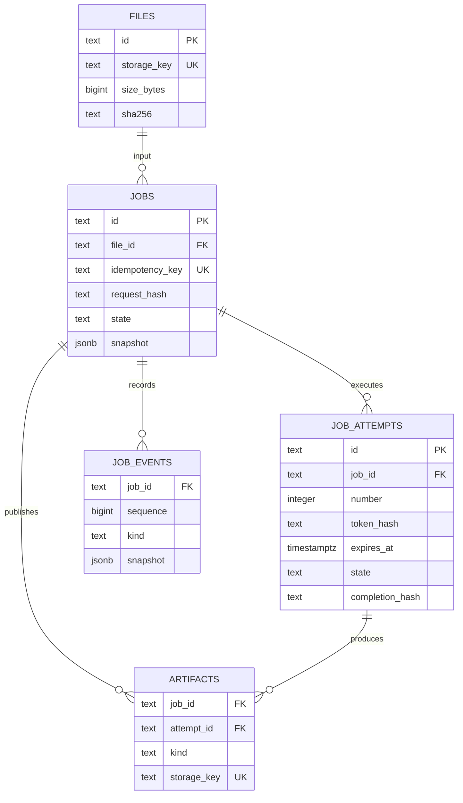
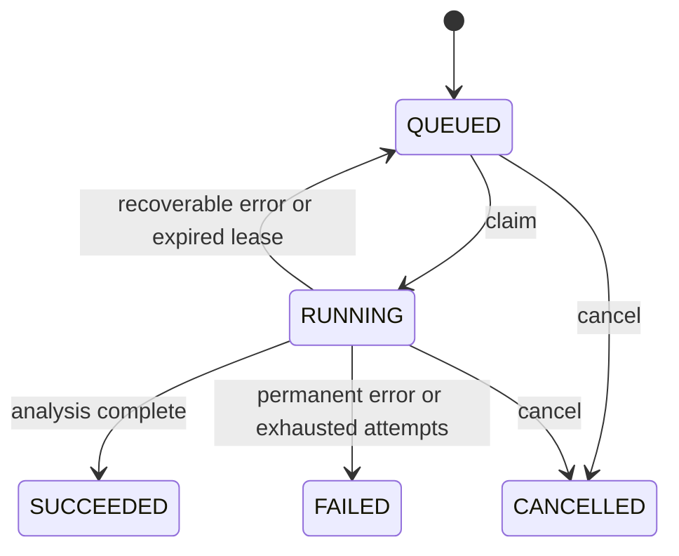
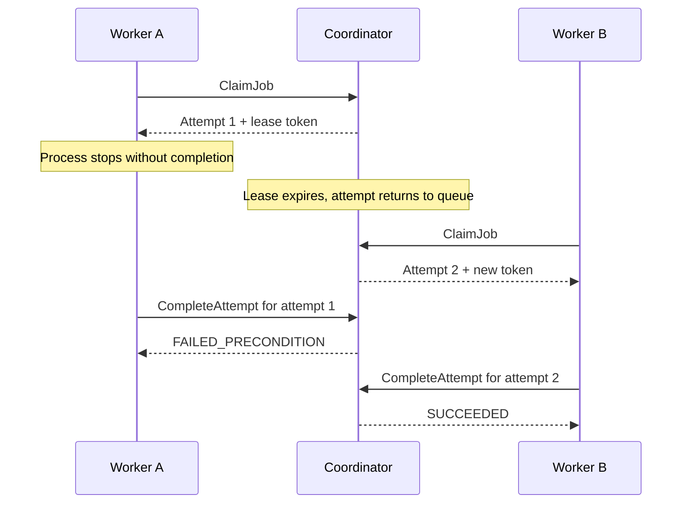

# Architecture

## Boundaries

The domain and validation packages depend on the Go standard library.
The coordinator uses repository and file-storage interfaces. PostgreSQL and the filesystem implement those interfaces.
The transport package translates Protobuf messages and domain errors. Command packages connect the components.

The coordinator owns scheduling and job state. Workers own CSV parsing and report creation.
Workers never connect to PostgreSQL. The CLI uses only the public gRPC API.

The local filesystem adapter requires a shared volume. A future object-storage adapter needs explicit worker download and upload operations.
Replacing a filesystem path with an S3 key alone is insufficient.

## Data model

The job snapshot contains immutable rules, progress, counters, and timestamps.
Relational columns support queue selection and uniqueness constraints. Each transition updates the snapshot and its event in one transaction.
The repository owns both representations.

The schema is an initial, idempotent bootstrap. It is not a migration framework for future schema changes.

## Job states

`SUCCEEDED` means that the analysis finished. Its outcome is `PASSED` or `FAILED_VALIDATION`.
A missing required column produces a validation violation at record zero. A malformed header or record fails the attempt permanently.

## Ownership and recovery

Workers claim jobs with `FOR UPDATE SKIP LOCKED`. The claim creates a new attempt and a random lease token.
Only the token hash enters PostgreSQL. Workers renew the lease every second.

The database clock decides lease validity. The default lease lasts 15 seconds.
The coordinator scans expired attempts each second, in batches of at most 100 jobs.
Expired attempts return to the queue until the third attempt fails.

Every heartbeat, failure, and completion checks the current attempt, token, state, and expiry.
A stale worker cannot publish a result, even after it finishes the file.

## Idempotency and cancellation

A submission key identifies one file and configuration document. The same request returns the original job.
A different request with that key returns `ALREADY_EXISTS`.
Rule order is significant in the request fingerprint.

A repeated completion returns the original result only for the same attempt, token, summary, and ordered artifact list.
Changed completion data returns `ALREADY_EXISTS`.
Execution is at least once. Publication accepts one current attempt.

Cancellation takes the job lock and sets `CANCELLED` immediately.
The worker stops at its next heartbeat and parser cancellation check.
Completion and cancellation use the same lock. The first committed terminal transition wins.
A cancelled watch stops observation only. It does not cancel the job.

## Files and events

Uploads use temporary files and atomic rename. The coordinator registers only complete files.
Workers write reports under attempt-specific keys. Completion checks file sizes, hashes, and the summary before publication.

Files and PostgreSQL have no shared transaction. A crash can leave an unreferenced file, but no partial report becomes a published artifact.
Automatic orphan cleanup is outside the MVP.

Events have a sequence within each job. `WatchJob` replays events after the supplied sequence and then polls PostgreSQL every 200 milliseconds.
The stream ends after the terminal event. Reconnection uses the last received sequence.
This design favors simplicity over high fan-out. Event retention is currently unlimited.
